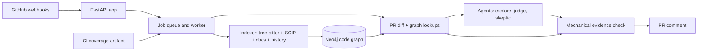

## Why I built this

Code review tools show you the diff. The bugs I keep seeing in review are not in the diff. They are in the caller three files away that still passes the argument you just removed, the README section that still says "rounded down", or the config file that always changes with this one and didn't this time.

A reviewer can catch those, but only by holding the whole repo in their head. I wanted a bot that does that part: build a graph of the repository once, keep it current on every push, and on each PR ask "what else did this touch?"

I also wanted it to be honest. If it can prove something from the code, say so. If a model guessed, label it. If it doesn't know, don't pretend.

## How it works

Pushes to the default branch keep a code graph up to date in Neo4j: files, functions, classes, calls, inheritance, imports, doc sections and the code they describe, which tests reach which function, and which files change together in git history. Calls are resolved with SCIP indexers first (real type analysis) and fall back to tree-sitter rules when that fails. When CI finishes, the bot reads a coverage artifact so "which test runs this" comes from real test runs, not only static reachability.

When a PR opens, the bot diffs it, looks up the changed symbols in the graph and builds a report from what the graph can prove. If a model is configured, a pipeline of agents then checks those candidates, a skeptic re-checks each finding, and every cited line or graph path is verified mechanically before anything is posted. The result is one comment per PR that gets updated as the PR changes.

The comment looks like this (from the demo fixture):

```
### BeyondDiff: 3 things to check before merging

1 caller will break · 1 doc out of date · 1 other file to update · 2 tests worth running

- **F1** `refund_amount()` in `refunds/service.py:6`: still passes the removed `mode`
  argument, so refunds raise TypeError
- **F2** `README.md:3`: Pricing: says discounts are rounded down, the default is now half_up
- **F3** `tax/rates.py`: usually changes with `pricing/discount.py` (6 of 7 commits) and
  the new CH region has no tax rate
```



## Key features

- **Works without a model.** With no API key the bot still posts what the graph proves: removed code that is still called, docstrings naming removed parameters, code coverage shows no test runs, and the candidates to look at. Every model limit (tokens, cost, daily runs, outages) falls back to this report.
- **Six-stage agent pipeline.** Plan, explore (one agent per changed function reads every caller), judge (docs and companion files), challenge, verify, write. State is checkpointed after every step, so a worker that dies resumes where it stopped.
- **A skeptic that doesn't see the reasoning.** Each model finding is re-checked by a fresh agent that gets only the claim and its evidence references and reads the code itself. Refuted findings are dropped, unsure ones are marked uncertain.
- **Evidence or it didn't happen.** A finding must cite code lines or graph paths. Code then checks the call path exists, the lines exist at that commit and the co-change counts are real.
- **Coverage-backed test claims.** Per-test coverage from the repo's own CI says which tests ran which function. Without coverage, the bot says the test list "may be incomplete" and never claims code is untested.
- **A learned layer.** What the model works out about ambiguous calls and unlinked docs is stored apart from the static graph, goes stale when the underlying file changes, and only becomes "confirmed" when the skeptic, a second run or coverage agrees.
- **Feedback from reviewers.** `/beyonddiff wrong F3` or `/beyonddiff useful F1` from someone with write access adjusts what gets suggested next time.

## Project structure and stack

```
beyonddiff/
  adapters/     # one per language (python, typescript): parsing, call resolution, coverage reading
  scip/         # vendored SCIP protobuf, reader and runner for the precise indexers
  indexer/      # builds and incrementally updates the graph; docs linking and git history mining
  graph/        # graph schema and the Neo4j store
  analysis/     # diff, graph lookups, the no-model report, the PR comment
  agents/       # the agent pipeline, read-only tools, prompts, learned layer, feedback
  llm/          # model client with retries and caps, tool-using agent loop, tracing
  bot/          # webhooks, job queue, worker, GitHub client
  evals/        # eval harness: planted changes, ground truth in Docker, held-out repos
fixtures/
  shopdemo/     # tiny Python shop with written-down expected graph and findings
  shopdemo-ts/  # the same idea in TypeScript
tests/          # pytest suite, runs against a real Neo4j
```

Core technologies:

- **Python 3.12 + uv**: the whole service, dependency and lockfile management.
- **Neo4j**: stores the code graph and the learned facts; graph queries answer "who calls this" and "which tests reach this".
- **tree-sitter**: parses Python and TypeScript into symbols, calls and docstrings; the rules-only fallback for call resolution.
- **SCIP (scip-python, scip-typescript)**: type-aware call resolution, tried first.
- **FastAPI + uvicorn**: webhook receiver, health and status pages.
- **LangGraph + SQLite checkpoints**: runs the agent pipeline and resumes it after a crash.
- **OpenAI-compatible chat API**: any compatible endpoint, with token and dollar caps per PR.
- **OpenTelemetry + Phoenix**: one trace per run with every agent, model call and tool call.
- **Docker Compose**: app, Neo4j and Phoenix locally; the eval harness also runs repo test suites in a no-network container.

## Decisions and tradeoffs

- **The bot never runs your code.** It only reads the repo and takes coverage from your CI. That keeps it safe to install, but it means the static graph misses calls: dynamic dispatch, callbacks and decorators are the usual gaps. On Click, 70% of the calls the test suite really made are in the graph. Coverage closes most of that gap for test claims, so I lean on it instead of executing anything.
- **Only resolved calls count toward "tested".** If a call is ambiguous (say `renderer.render()` on an untyped parameter), the code behind it gets no TESTS edge, even when a human can see it's exercised. I'd rather under-claim coverage than tell someone their code is tested when it isn't. The fixture documents this as a deliberate trap.
- **Precise first, rules as fallback.** SCIP gives real types but is a Node tool that can fail or be missing, so there are two resolution modes and two expected graphs for the fixture. More to maintain, but the bot degrades instead of breaking.
- **Spend tokens on doubt.** A skeptic per finding plus mechanical verification costs roughly 50 to 150k tokens per PR. I accepted that because a PR bot that posts confident wrong comments gets uninstalled fast. Hard caps and the no-model fallback keep it bounded.

## What was hard

- **tree-sitter corrupting memory.** tree-sitter 0.26.0 corrupted memory on some files (Click's `imagepipe.py` was one). The fix was boring and important: pin `tree-sitter>=0.25.2,<0.26` with a comment saying why, so nobody "helpfully" upgrades it.
- **Losing coverage on re-index.** When a newer indexer version rewrote a file whose content hadn't changed, it deleted the file's symbols and with them the coverage-derived TESTS edges, which only come back after the next CI run. The fix compares the content hash before rewriting and restores coverage edges when the content is identical. A related fix rebuilds the whole graph when the indexer version changes, instead of mixing old and new output.
- **Python's `@overload`.** The parser folded redefinitions into the first definition, which is right for property setters but wrong for overloads: it indexed the first type-only stub instead of the implementation that actually runs. Now an implementation after `@overload` stubs replaces them.

## Testing and evals

The test suite is pytest (225 tests collected) and runs against a real Neo4j; no model is called, a fake model stands in. It covers the Python and TypeScript adapters, precise and rules-only resolution, the indexer and Neo4j store, docs linking, history mining, the no-model report against golden fixtures, the agent pipeline and tools, the bot end to end, feedback and the eval harness itself. The `shopdemo` fixtures are small repos with every expected node, edge and finding written down in advance, including planted traps like a false companion file and a refactor that changes nothing. CI runs ruff and the full suite with a Neo4j service and fails if the Neo4j test is skipped.

```bash
uv sync
scripts/install-tools.sh     # scip-python and scip-typescript into .tools/
docker compose up -d neo4j
uv run pytest -q
uv run ruff check . && uv run ruff format --check .
```

There is also an eval harness (`python -m beyonddiff.evals`): it plants changes in real functions, runs the repo's own tests in Docker for ground truth, replays each case through every mode (baseline, single agent, explorers, full, and a no-graph agent for comparison) and scores callers, docs and companions. It is built, but the measured results are not published yet.

## What's next

- Run the full evaluation on the held-out repositories and publish the numbers in the README.
- Close more of the static call graph gap (dynamic dispatch, callbacks, decorators).
- Languages beyond Python and JavaScript/TypeScript; very large repos are currently refused with a pointer to the `ignore` setting.
